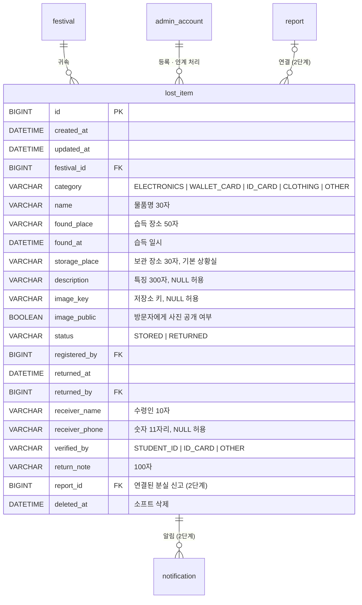

# 분실물센터 백엔드 요청 (ERD · API 계약)

작성일: 2026-11-11
상태: 초안 3판(프런트 화면 구현 완료, 서버 연동 대기). 구현 전에 "8. 확인이 필요한 것"부터 협의 부탁드립니다.
관련 문서: [lost-found-spec.md](./lost-found-spec.md) (요구사항 · 플로우 · 화면)

## 1. 요약

상황실(총괄 관리자)이 습득물을 사진과 함께 등록하고, 방문자가 목록·상세를 조회한 뒤 직접 방문해 찾아가는 기능입니다.

새로 필요한 것은 세 가지입니다.

1. `lost_item` 테이블과 방문자·관리자 API
2. **이미지 업로드와 서빙**. 현재 백엔드에 파일 업로드가 없어 새로 추가해야 합니다(지도 도면은 URL 문자열만 저장). 저장 방식은 "3.1 사진 저장" 참고
3. (2단계) 습득물과 분실 신고 연결, 신고자 알림

기존 관례를 그대로 따릅니다: `/api/v1` 접두, `{ success, data }` 응답 봉투, 시각은 `+09:00` 오프셋 문자열, 활성 축제 귀속, 관리자 요청은 세션 + CSRF, 페이지 응답은 신고 목록과 같은 모양(`content`, `page`, `size`, `totalElements`, `totalPages`, `summary`, `serverTime`).

## 1.1 프런트 구현 현황 (2026-11-13)

화면과 API 호출 코드는 이미 들어가 있습니다. 서버에 아래 API가 생기면 추가 작업 없이 동작하도록 이 문서의 계약대로 작성했습니다. **지금은 서버에 API가 없어서 분실물센터 화면에 들어가면 오류 문구가 뜹니다.**

| 프런트 파일 | 내용 |
| --- | --- |
| `src/apis/lostItem.ts` | 타입과 호출 함수. 계약이 바뀌면 이 파일만 고치면 됩니다 |
| `src/pages/LostFoundPages.tsx` | 방문자 목록·상세 |
| `src/pages/AdminLostItemPages.tsx` | 관리자 목록·등록/수정·상세·인계 처리 |
| `tests/lost-found.spec.ts` | 이 문서의 응답 모양을 흉내 낸 가짜 서버로 검증한 테스트. 응답 예시로 참고할 수 있습니다 |

### 화면별 호출

| 화면 (경로) | 시점 | 호출 | 비고 |
| --- | --- | --- | --- |
| 방문자 목록 `/lost-found` | 진입, 조건 변경 | `GET /lost-items?category=&status=&q=&page=` | 자동 갱신 없음. "보관 중만 보기"를 끄면 `status=ALL`, 켜면 `status` 생략. `q`는 2자 이상일 때만 보냄 |
| 〃 | 카드 표시 | `thumbnailUrl`을 ``로 요청 | 쿠키·헤더 없이 가는 단순 GET |
| 방문자 상세 `/lost-found/:id` | 진입 | `GET /lost-items/{id}` | `404`면 "찾을 수 없는 습득물이에요" 화면. 인계 완료도 `404`여야 함 |
| 관리자 목록 `/admin/lost-items` | 진입, 10초마다, 조건 변경 | `GET /admin/lost-items?category=&status=&page=` | `summary`로 상단 건수 카드 표시. `status`는 `STORED` / `RETURNED` / 생략 |
| 관리자 상세 `/admin/lost-items/:id` | 진입 | `GET /admin/lost-items/{id}` | |
| 〃 | "인계 완료 처리" 팝업 제출 | `POST /admin/lost-items/{id}/return` | |
| 〃 | "인계 취소" 확인 | `POST /admin/lost-items/{id}/reopen` | |
| 〃 | "연락처 보기" | `GET /admin/lost-items/{id}/contact` | |
| 〃 | "삭제" 확인 | `DELETE /admin/lost-items/{id}` | `204` 기대 |
| 등록 `/admin/lost-items/new` | "등록하기" | (사진이 있으면) `POST /admin/lost-items/images` → `POST /admin/lost-items` | 사진 업로드가 먼저, 받은 `imageKey`를 등록 요청에 실음 |
| 수정 `/admin/lost-items/:id/edit` | 진입 | `GET /admin/lost-items/{id}` | |
| 〃 | "저장하기" | (새 사진이 있으면) `POST …/images` → `PATCH /admin/lost-items/{id}` | 아래 `imageKey` 규칙 참고 |

### 프런트가 기대하는 동작 (어긋나면 화면이 깨지는 부분)

- **응답 봉투**: `{ "success": true, "data": … }`. `204`만 본문 없음. 봉투가 없으면 프런트가 "서버 응답을 읽을 수 없습니다"로 처리합니다.
- **오류 문구**: `error.message`를 화면에 그대로 보여줍니다. 한국어 문장으로 내려주세요.
- **사진 업로드 요청**: `multipart/form-data`, 필드 이름 `file`, 파일 이름은 항상 `photo.jpg`. 프런트가 올리기 전에 긴 변 1280px JPEG로 줄이므로 대부분 수백 KB입니다(줄이지 못한 환경에서는 원본 PNG·WebP가 그대로 갈 수 있음). 응답에서는 `imageKey`만 씁니다.
- **`PATCH`의 `imageKey`**: 필드가 없으면 사진 유지, 문자열이면 교체, `null`이면 사진 제거. 나머지 필드는 수정 화면에서 항상 전부 보냅니다.
- **`imageUrl` / `thumbnailUrl`**: ``에 그대로 넣습니다. 프런트와 같은 출처의 경로(`/api/v1/...`)나 절대 URL이면 됩니다. 관리자 응답의 사진 주소는 세션 쿠키만으로 열려야 합니다(이미지 요청에는 CSRF 헤더를 붙일 수 없음).
- **시각**: 요청의 `foundAt`은 `2026-11-11T17:40:00+09:00` 형식(초는 항상 `00`). 응답 시각도 오프셋이 붙은 문자열이어야 화면에 한국 시간으로 표시됩니다.
- **방문자 응답의 인계 완료 항목**: `foundPlace`, `foundAt`, `storagePlace`, `description`, `imageUrl`, `thumbnailUrl`, `elapsedMinutes`는 필드를 빼지 말고 `null`로 내려주세요.
- **관리자 상세의 수령인 이름**: 상세에서는 전체 이름, 목록에서는 사용하지 않습니다(마스킹해도 무방).
- **권한**: 메뉴는 `SUPER_ADMIN`에게만 보이지만 주소로 직접 들어올 수 있으므로 서버가 `403 A003`으로 막아야 합니다.
- **2단계(분실 신고 연결)**: 프런트에 아직 넣지 않았습니다. 7장의 API는 지금 만들지 않아도 됩니다.

## 2. ERD



### 마이그레이션 초안

```sql
CREATE TABLE lost_item (
    id BIGINT AUTO_INCREMENT PRIMARY KEY,
    created_at DATETIME(3) NOT NULL,
    updated_at DATETIME(3) NOT NULL,
    festival_id BIGINT NOT NULL,
    category VARCHAR(20) NOT NULL,           -- ELECTRONICS | WALLET_CARD | ID_CARD | CLOTHING | OTHER
    name VARCHAR(30) NOT NULL,
    found_place VARCHAR(50) NOT NULL,
    found_at DATETIME(3) NOT NULL,
    storage_place VARCHAR(30) NOT NULL,
    description VARCHAR(300),
    image_key VARCHAR(200),
    image_public BOOLEAN NOT NULL DEFAULT TRUE,
    status VARCHAR(20) NOT NULL,             -- STORED | RETURNED
    registered_by BIGINT NOT NULL,
    returned_at DATETIME(3),
    returned_by BIGINT,
    receiver_name VARCHAR(10),
    receiver_phone VARCHAR(11),
    verified_by VARCHAR(20),                 -- STUDENT_ID | ID_CARD | OTHER
    return_note VARCHAR(100),
    report_id BIGINT,                        -- 2단계
    deleted_at DATETIME(3),
    CONSTRAINT fk_lost_item_festival FOREIGN KEY (festival_id) REFERENCES festival(id),
    CONSTRAINT fk_lost_item_registered_by FOREIGN KEY (registered_by) REFERENCES admin_account(id),
    CONSTRAINT fk_lost_item_returned_by FOREIGN KEY (returned_by) REFERENCES admin_account(id),
    CONSTRAINT fk_lost_item_report FOREIGN KEY (report_id) REFERENCES report(id)
);
CREATE INDEX idx_lost_item_list ON lost_item (festival_id, deleted_at, status, created_at);
CREATE INDEX idx_lost_item_category ON lost_item (festival_id, deleted_at, category, created_at);
```

`created_at` / `updated_at`은 [접수시간 시간대 문제](./backend-request-report-created-at-timezone.md)가 고쳐진 뒤의 KST 기준을 전제로 합니다.

## 3. 공통 규칙

| 항목 | 규칙 |
| --- | --- |
| 권한 | 관리자 API는 `SUPER_ADMIN`만. 그 외 `403 A003` |
| 서버 강제 비공개 | `category`가 `ID_CARD` 또는 `WALLET_CARD`이면 요청 값과 무관하게 `image_public = false`로 저장 |
| 방문자 응답 | `image_public = false`이면 `imageUrl`, `thumbnailUrl`을 `null`로 내려줌. 수령인 정보·등록자·`report_id`는 방문자 응답에 절대 포함하지 않음 |
| 인계 완료 항목 (방문자) | 단건 조회는 삭제된 항목과 똑같이 `404 L001`. 목록에서는 `lostItemId`, `category`, `name`, `status`, `createdAt`만 채우고 나머지(`foundPlace`, `foundAt`, `description`, `imageUrl`, `thumbnailUrl`, `elapsedMinutes`)는 `null`. 사진 요청도 `404` |
| 삭제된 항목 | 방문자·관리자 모두 목록에서 제외, 단건 조회는 `404 L001` |
| 정렬 | `created_at DESC, id DESC` |
| 경과 시간 | 목록·상세 응답에 `elapsedMinutes`(등록 후 경과 분) 포함. 신고와 같은 방식 |

### 3.1 사진 저장 (추천안)

현재 인프라(EC2 한 대, Docker Compose, MySQL 컨테이너, RDS 미사용)에 맞춰 **EC2 디스크에 파일로 저장하고 백엔드가 직접 내려주는 방식**을 추천합니다.

- `docker-compose.yml`의 `backend`에 볼륨 추가(예: `uploads:/data/uploads`), 경로는 환경 변수(`KUFIM_UPLOAD_DIR`)로.
- DB에는 `image_key`(상대 경로)만 저장. 원본(긴 변 1280px)과 썸네일(400px) 두 파일.
- 서빙은 Caddy 정적 경로가 아니라 **API**로 합니다. 비공개 사진과 인계 완료 물건의 사진을 막아야 하기 때문입니다.
  - `GET /lost-items/{id}/image?size=thumb|full`: `image_public = true`이고 `STORED`일 때만. 그 외 `404`. `Cache-Control: public, max-age=300`
  - `GET /admin/lost-items/{id}/image?size=thumb|full`: 관리자 세션 필요. `Cache-Control: private`
- 응답의 `imageUrl`, `thumbnailUrl`에는 위 경로(`/api/v1/lost-items/12/image?size=full`)를 넣어 주세요. `/api` 아래라서 Caddy·Vercel 프록시 설정을 바꿀 필요가 없습니다.
- 업로드 크기 때문에 `spring.servlet.multipart.max-file-size=5MB`, Caddy `request_body` 제한 확인이 필요합니다.
- MySQL BLOB 저장은 피해 주세요. `mysqldump` 백업이 커지고 `t3.small` 메모리를 압박합니다.
- S3로 가도 계약은 같습니다(`imageUrl`만 달라짐). 다만 비공개 사진 때문에 서명 URL이나 백엔드 경유가 필요합니다.
- 인스턴스를 종료하면 사진도 사라지므로, 백업이 필요하면 `deploy/README.md`의 백업 절차에 볼륨 압축을 추가해 주세요.

### 응답 객체

방문자용 `LostItem`:

```json
{
  "lostItemId": 12,
  "category": "ELECTRONICS",
  "name": "검은색 에어팟 케이스",
  "foundPlace": "노천극장 객석 3열",
  "foundAt": "2026-11-11T17:20:00+09:00",
  "storagePlace": "상황실",
  "description": "케이스에 곰돌이 스티커가 붙어 있음",
  "status": "STORED",
  "imageUrl": "/api/v1/lost-items/12/image?size=full",
  "thumbnailUrl": "/api/v1/lost-items/12/image?size=thumb",
  "createdAt": "2026-11-11T17:40:00+09:00",
  "elapsedMinutes": 12
}
```

관리자용 `AdminLostItem`은 위 필드에 아래를 더합니다.

```json
{
  "imagePublic": true,
  "registeredBy": { "accountId": 1, "name": "총괄 관리자" },
  "returnedAt": "2026-11-11T18:05:00+09:00",
  "returnedBy": { "accountId": 1, "name": "총괄 관리자" },
  "receiverName": "김*국",
  "receiverPhoneMasked": "010-****-1234",
  "verifiedBy": "STUDENT_ID",
  "returnNote": "학생증 확인",
  "linkedReport": null
}
```

관리자 응답은 `image_public`과 무관하게 `imageUrl`을 항상 내려줍니다. `receiverName`은 관리자 목록에서는 마스킹, 상세에서는 전체를 내려줍니다.

## 4. 방문자 API

### 4.1 `GET /lost-items` 습득물 목록

| 파라미터 | 타입 | 설명 |
| --- | --- | --- |
| `category` | enum, 선택 | 분류 조건 |
| `status` | enum, 선택 | 생략 시 `STORED`만. `ALL`이면 전체 |
| `q` | string, 선택 | 물품명·습득 장소 부분 일치, 2~30자 |
| `page`, `size` | int | 기본 0, 20 (최대 50) |

응답 `data`:

```json
{
  "content": [ /* LostItem */ ],
  "page": 0, "size": 20, "totalElements": 7, "totalPages": 1,
  "serverTime": "2026-11-11T17:52:00+09:00"
}
```

### 4.2 `GET /lost-items/{lostItemId}` 습득물 상세

응답 `data`: `LostItem`. 없거나 삭제됨, **또는 인계 완료(`RETURNED`)** → `404 L001`. 인계 완료 여부를 응답으로 구분할 수 없게 같은 코드·메시지를 씁니다.

### 4.3 `GET /lost-items/{lostItemId}/image` 사진

`size=thumb|full`(기본 `full`). 공개 사진이고 보관 중일 때만 이미지 바이트를 내려줍니다. 그 외 `404`.

## 5. 관리자 API

모두 `/admin` 접두, 세션 + CSRF 필요.

### 5.1 `GET /admin/lost-items` 목록

파라미터는 4.1과 같되 `status` 생략 시 전체. 응답에 건수 요약이 추가됩니다.

```json
{
  "summary": { "stored": 7, "returned": 12, "total": 19 },
  "content": [ /* AdminLostItem */ ],
  "page": 0, "size": 20, "totalElements": 19, "totalPages": 1,
  "serverTime": "2026-11-11T17:52:00+09:00"
}
```

`summary`는 조회 조건과 무관하게 활성 축제 전체 기준입니다.

### 5.2 `GET /admin/lost-items/{lostItemId}` 상세

응답 `data`: `AdminLostItem`.

### 5.3 `POST /admin/lost-items/images` 사진 업로드

`multipart/form-data`, 필드 `file` 1개.

| 검증 | 실패 시 |
| --- | --- |
| 형식: JPEG, PNG, WebP (확장자가 아니라 실제 내용으로 판별) | `400 L003` |
| 크기: 5MB 이하 | `413 L004` |

서버 처리: EXIF 제거(위치 정보 포함), 긴 변 1280px로 축소한 원본과 긴 변 400px 썸네일 생성.

응답 `201`:

```json
{ "imageKey": "lost-items/2026/8f3c…e1.jpg" }
```

등록에 쓰이지 않은 이미지는 24시간 뒤 정리합니다.

### 5.4 `POST /admin/lost-items` 등록

```json
{
  "category": "ELECTRONICS",
  "name": "검은색 에어팟 케이스",
  "foundPlace": "노천극장 객석 3열",
  "foundAt": "2026-11-11T17:20:00+09:00",
  "storagePlace": "상황실",
  "description": "케이스에 곰돌이 스티커가 붙어 있음",
  "imageKey": "lost-items/2026/8f3c…e1.jpg",
  "imagePublic": true
}
```

| 필드 | 규칙 |
| --- | --- |
| `category` | 필수, enum |
| `name` | 필수, 공백 제외 1~30자 |
| `foundPlace` | 필수, 1~50자 |
| `foundAt` | 필수, 현재 시각 이전 |
| `storagePlace` | 선택, 1~30자. 생략 시 "상황실" |
| `description` | 선택, 300자 이하 |
| `imageKey` | 선택. 5.3에서 받은 값만 허용, 그 외 `400 L003` |
| `imagePublic` | 선택, 기본 `true`. 민감 분류는 서버가 `false`로 강제 |

응답 `201`: `AdminLostItem` (`status = STORED`). 검증 실패 → `400 C001`.

### 5.5 `PATCH /admin/lost-items/{lostItemId}` 수정

5.4와 같은 필드를 부분 수정. `imageKey: null`이면 사진 제거. 인계 완료 상태에서도 수정 가능(오타 정정 용도). 응답: `AdminLostItem`.

### 5.6 `POST /admin/lost-items/{lostItemId}/return` 인계 완료

```json
{ "receiverName": "김건국", "receiverPhone": "01012341234", "verifiedBy": "STUDENT_ID", "returnNote": "학생증 확인" }
```

| 필드 | 규칙 |
| --- | --- |
| `receiverName` | 필수, 1~10자 |
| `receiverPhone` | 선택, 숫자 11자리 |
| `verifiedBy` | 필수, `STUDENT_ID` / `ID_CARD` / `OTHER` |
| `returnNote` | 선택, 100자 이하 |

`STORED`일 때만 가능, 이미 인계 완료면 `409 L002`. `returned_at`, `returned_by`를 기록하고 감사 로그를 남깁니다. 응답: `AdminLostItem`.

### 5.7 `POST /admin/lost-items/{lostItemId}/reopen` 인계 취소

`RETURNED` → `STORED`. 수령인 정보와 인계 시각을 비웁니다. 감사 로그 기록. `STORED`이면 `409 L002`. 응답: `AdminLostItem`.

### 5.8 `GET /admin/lost-items/{lostItemId}/contact` 수령인 연락처 보기

응답: `{ "phoneNumber": "01012341234" }`. 신고의 연락처 보기와 같은 방식으로 열람 기록을 남깁니다. 연락처가 없으면 `404 L001`.

### 5.9 `DELETE /admin/lost-items/{lostItemId}` 삭제

소프트 삭제(`deleted_at` 기록), 사진 파일은 즉시 삭제. 응답 `204`.

## 6. 오류 코드

| HTTP | 코드 | 메시지 | 상황 |
| --- | --- | --- | --- |
| 404 | `L001` | 습득물을 찾을 수 없습니다. | 없음·삭제됨·(방문자) 인계 완료 |
| 409 | `L002` | 이미 처리된 습득물입니다. | 인계 완료·취소 중복 |
| 400 | `L003` | 지원하지 않는 이미지입니다. | 형식 오류, 알 수 없는 `imageKey` |
| 413 | `L004` | 이미지는 5MB 이하만 올릴 수 있습니다. | 용량 초과 |
| 400 | `C001` | 입력값을 확인해 주세요. | 필드 검증 실패(기존) |
| 403 | `A003` | 접근 권한이 없습니다. | SUPER_ADMIN 아님(기존) |

## 7. 2단계: 분실 신고 연결 (지금은 구현 불필요, 스키마만 대비)

- `GET /admin/lost-items/{lostItemId}/report-candidates`: 연결할 만한 분실 신고 후보(최대 5건).
  - 대상: 같은 축제, `category = LOST_ITEM`, 상태가 `SUBMITTED` / `RECEIVED` / `IN_PROGRESS`인 신고.
  - 습득물 `name`을 공백으로 나눈 2자 이상 단어가 신고 `title` 또는 `content`에 포함된 것만. 일치 단어 수 내림차순, 같으면 최신순.
  - 일치하는 단어가 없으면 빈 배열. 응답 항목은 관리자 신고 목록의 항목과 같은 모양.
  - 건수가 적으므로 단어별 `LIKE`로 충분합니다. 자동 연결은 하지 않습니다(관리자 확인 후 아래 API 호출).
- `PUT /admin/lost-items/{lostItemId}/report` `{ "reportId": 31 }`: 분실물 유형(`LOST_ITEM`) 신고와 연결. 다른 유형이면 `400 C001`. `{ "reportId": null }`로 해제.
- 연결 시 신고자(`report.client_token`)에게 알림 생성: `type = LOST_ITEM_MATCHED`, `lost_item_id` 참조, 제목 "찾으시는 물건이 등록되었어요". 방문자 알림 응답에 `lostItemId`를 넣어 `/lost-found/{id}`로 이동할 수 있게 합니다.
- `notification`에 `lost_item_id` 컬럼을 추가하고 **`ck_notification_source` 제약에 새 타입 조건을 함께 추가**해야 합니다([신고 알림 제약 문제](./backend-request-report-notification-constraint.md)와 같은 실수를 피하기 위해).
- 관리자 신고 상세 응답에 `linkedLostItems` 추가.

## 8. 확인이 필요한 것

| # | 질문 | FE 제안 |
| --- | --- | --- |
| 1 | 사진을 어디에 저장하나 | 3.1의 추천안(EC2 디스크 + 백엔드 서빙)으로 진행해도 되는지. 컨테이너 재배포 시 볼륨 유지 필요 |
| 2 | 업로드 직후 미리보기 | 필요 없음. 프런트가 고른 파일을 기기에서 바로 미리 보여줍니다 |
| 3 | 업로드와 등록을 한 번에(`multipart`) 할지, 지금처럼 나눌지 | 나누는 쪽. 수정 시 사진만 교체하기 쉽고 JSON 계약이 단순함 |
| 4 | 검색 방식 | 건수가 적으므로 `LIKE %q%`로 충분 |
| 5 | 개인정보 파기 | 기존 `POST /admin/privacy/purge`에 `lost_item`의 수령인 이름·연락처 마스킹과 사진 삭제 포함 |
| 6 | 요청 제한 | 방문자 목록은 기존 IP당 제한에 포함. 업로드는 계정당 분당 30건 정도 |
| 7 | 테스트 | 등록 → 인계 → 취소 → 삭제 통합 테스트, 민감 분류의 방문자 응답에 `imageUrl`이 없는지, 인계 완료 물건의 방문자 상세·사진이 `404`인지 검증 |

### 기획에서 확정된 것 (2026-11-11)

- 분류는 5개로 확정.
- 방문자 목록은 실시간 갱신·폴링을 하지 않습니다(진입·새로고침 때만 조회). STOMP 토픽은 필요 없습니다.
- 상황실 운영 시간은 축제 운영 시간과 같아 별도 필드가 필요 없습니다.
- 축제 후 남은 물건은 총학생회로 이관하며, 이를 위한 상태 값은 추가하지 않습니다.
