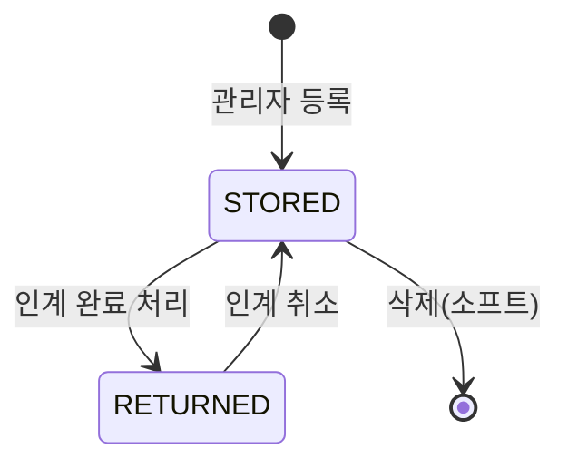
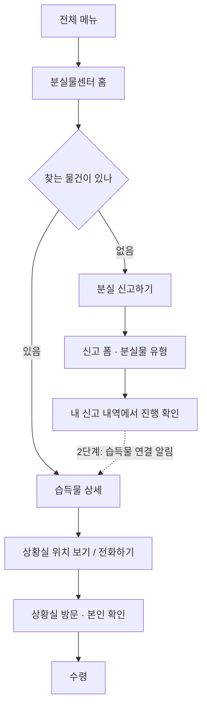
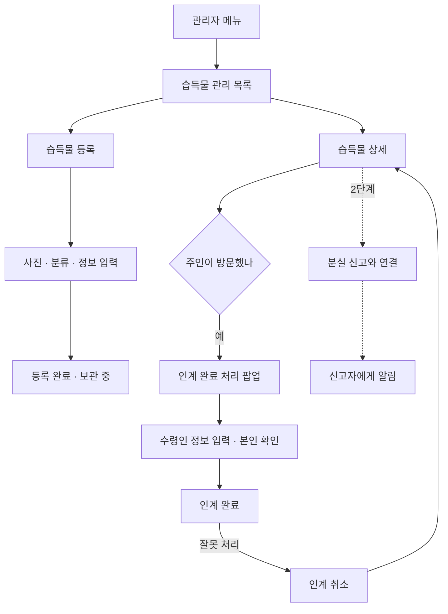
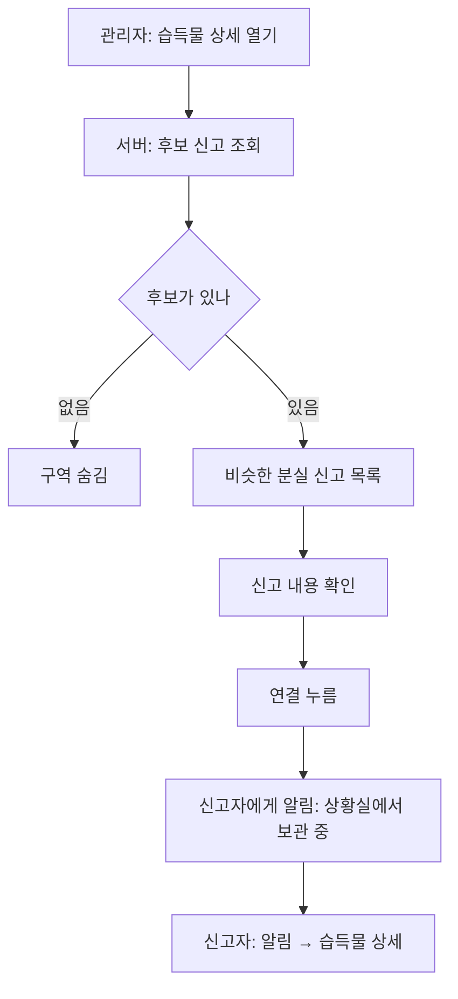

# 분실물센터 기능 명세 (요구사항 · 플로우 · 화면)

작성일: 2026-11-11
상태: 초안 2판 (기획 결정 반영, 백엔드 협의 전)
관련 문서: [backend-request-lost-found.md](./backend-request-lost-found.md) (ERD · API 계약), [mockups/lost-found-mockup.html](./mockups/lost-found-mockup.html) (화면 시안)

## 1. 방향

**상황실이 보관 중인 습득물을 방문자가 앱에서 찾아보고, 직접 방문해 찾아가는 게시판**으로 만든다.

- 습득물은 총괄 관리자(상황실)만 등록한다. 방문자가 직접 올리는 "주웠어요" 글은 받지 않는다. 물건은 어차피 상황실로 모이고, 방문자 게시글은 허위·개인정보 노출 관리가 어렵다.
- 수령은 온라인 신청 없이 **상황실 방문 + 본인 확인**으로만 한다. 앱은 "어디에 무엇이 있는지"와 "어떻게 찾아가는지"만 안내한다.
- "잃어버렸어요" 접수는 새로 만들지 않고 **기존 긴급 신고의 분실물 유형**을 그대로 쓴다. 분실물센터에서 "분실 신고하기"를 누르면 신고 폼이 분실물 유형으로 열린다.
- 관리자는 습득물을 분실 신고와 연결할 수 있고, 연결하면 신고자에게 알림이 간다(2단계, 4.3 참고).
- 인계가 끝난 물건은 방문자가 상세를 열 수 없다. 누가 무엇을 찾아갔는지 추측할 단서를 남기지 않기 위해서다.

### 범위

| 단계 | 내용 |
| --- | --- |
| 1단계 (MVP) | 습득물 등록·수정·삭제, 사진 1장, 방문자 목록·검색·상세, 인계 완료 처리 |
| 2단계 | 분실 신고와 습득물 연결, 신고자 알림 |
| 제외 | 방문자의 습득물 등록, 온라인 수령 신청, 택배 발송, 채팅 |

## 2. 요구사항

### 2.1 기능 요구사항

| ID | 구분 | 요구사항 | 단계 |
| --- | --- | --- | --- |
| F-01 | 방문자 | 보관 중인 습득물 목록을 최신 등록순으로 본다 | 1 |
| F-02 | 방문자 | 분류 칩(전체/전자기기/지갑·카드/신분증/의류·잡화/기타)으로 거른다 | 1 |
| F-03 | 방문자 | 물품명·습득 장소로 검색한다 | 1 |
| F-04 | 방문자 | "보관 중만 보기"를 끄면 인계 완료된 물건도 목록에 나온다. 사진 없이 이름만 보이고 눌러도 상세로 들어가지 않는다 | 1 |
| F-05 | 방문자 | 보관 중인 습득물의 상세(사진, 습득 장소·일시, 보관 장소, 특징)를 본다. 사진이 비공개인 물건은 사진 영역 없이 글자 정보만 나온다 | 1 |
| F-06 | 방문자 | 상세에서 상황실 위치 보기·전화하기로 이동한다 | 1 |
| F-07 | 방문자 | "분실 신고하기"로 신고 폼을 분실물 유형으로 연다 | 1 |
| F-08 | 관리자 | 습득물을 등록한다(사진 선택, 분류, 물품명, 습득 장소·일시, 보관 장소, 특징) | 1 |
| F-09 | 관리자 | 습득물을 수정·삭제한다 | 1 |
| F-10 | 관리자 | 상태별 건수(보관 중/인계 완료/전체)를 카드로 본다 | 1 |
| F-11 | 관리자 | 인계 완료 처리한다(수령인 이름, 연락처, 본인 확인 방법, 메모) | 1 |
| F-12 | 관리자 | 인계 완료를 취소해 보관 중으로 되돌린다 | 1 |
| F-13 | 관리자 | 습득물 상세에서 비슷한 분실 신고 후보를 보고, 확인한 뒤 연결한다 | 2 |
| F-14 | 방문자 | 내 분실 신고에 습득물이 연결되면 앱 알림을 받고, 알림에서 습득물 상세로 이동한다 | 2 |

### 2.2 정책

| 항목 | 결정 |
| --- | --- |
| 관리 권한 | `SUPER_ADMIN`만. 부스 관리자는 접근 불가 |
| 방문자 식별 | 로그인 없음. 조회는 누구나 가능 |
| 상태 | `STORED` 보관 중 → `RETURNED` 인계 완료. 인계 취소로 되돌릴 수 있음 |
| 분류 | `ELECTRONICS` 전자기기 / `WALLET_CARD` 지갑·카드 / `ID_CARD` 신분증 / `CLOTHING` 의류·잡화 / `OTHER` 기타 |
| 사진 | 1장, 선택. JPEG·PNG·WebP, 5MB 이하. 서버에서 긴 변 1280px로 줄여 저장 |
| 사진 공개 | 등록 시 "사진 공개" 스위치. `ID_CARD`·`WALLET_CARD`는 서버가 강제로 비공개 처리. 비공개인 물건의 상세에는 안내 문구나 대체 그림을 넣지 않고 사진 영역 자체를 없앤다 |
| 인계 완료 물건 | 방문자 상세 조회 차단(서버가 404). 목록에는 물품명·분류·상태만 내려주고 사진·특징·습득 장소는 내려주지 않는다 |
| 시각 표기 | 습득 일시는 날짜·시각만 적는다("11.11. 17:40"). "N분 전"은 목록의 등록 시각에만 쓴다 |
| 민감 정보 | 신분증·카드의 이름은 관리자가 입력할 때 가운데를 가려 적는다("김*국 학생증"). 학번·카드번호는 적지 않는다(입력 안내 문구로 고지) |
| 입력 길이 | 물품명 30자, 습득 장소 50자, 보관 장소 30자(기본값 "상황실"), 특징 300자, 인계 메모 100자. 제한은 라벨 옆이 아니라 입력칸의 placeholder("30자 이내")로 안내 |
| 사진 입력 | "사진 추가" 버튼은 가로 전체. 사진을 고르면 버튼 자리에 사진이 가로 전체로 들어가고, × 로 지우면 버튼으로 돌아간다 |
| 수령인 정보 | 이름(필수, 10자), 연락처(선택, 숫자 11자리), 본인 확인 방법(학생증/신분증/기타). 방문자 화면에는 노출하지 않음 |
| 연락처 보호 | 관리자 화면에서도 마스킹 표시, "연락처 보기"를 눌렀을 때만 전체 번호(열람 기록) |
| 삭제 | 소프트 삭제. 잘못 등록한 건을 지우는 용도 |
| 개인정보 파기 | 기존 파기 API에서 수령인 이름·연락처를 함께 마스킹하고 사진 파일을 삭제 |
| 갱신 | 방문자 목록은 자동 갱신 없음(화면에 들어올 때·새로고침할 때만 조회). 관리자 목록은 10초 폴링 |
| 상황실 운영 시간 | 축제 운영 시간과 같다. 별도 시각을 두지 않고 "축제 운영 시간과 동일"로 안내 |
| 축제 종료 후 | 남은 물건은 총학생회로 이관. 상태를 추가하지 않고 안내 카드에 문구로만 알린다 |
| 축제 범위 | 활성 축제에 귀속 |

### 2.3 비기능 요구사항

- 목록은 썸네일(긴 변 400px)을 쓰고 지연 로딩한다. 20건 단위 페이지.
- 사진 업로드 전 클라이언트에서 용량·형식을 검사하고, 큰 사진은 줄여서 올린다.
- 사진이 없거나 비공개인 물건도 **목록**에서는 자리(회색 블록, 문구 없음)를 유지해 2열 레이아웃이 흔들리지 않게 한다. 상세에서는 자리를 두지 않는다.
- 모든 버튼·칩은 키보드와 스크린리더로 조작할 수 있어야 한다(기존 `Chips`, `ConfirmDialog` 재사용).

## 3. 상태 모델

| 상태 | 표시 | 방문자 목록 | 배지 |
| --- | --- | --- | --- |
| `STORED` | 보관 중 | 기본 노출 | 초록 |
| `RETURNED` | 인계 완료 | "보관 중만 보기"를 껐을 때만 흐리게 노출. 사진 없음, 누를 수 없음 | 진회색 |

## 4. 플로우

### 4.1 방문자: 물건 찾기

### 4.2 관리자: 등록과 인계

### 4.3 분실 신고는 어떻게 찾아지나 (2단계)

자동으로 짝을 지어주지 않는다. 서버가 **후보를 추려 보여주고, 관리자가 내용을 확인한 뒤 직접 연결**한다. 신고는 자유 서술이라 자동 판정은 틀리기 쉽고, 틀리면 엉뚱한 사람에게 알림이 가기 때문이다.

후보를 고르는 규칙:

1. 유형이 분실물(`LOST_ITEM`)이고 상태가 신청·접수·처리 중인 신고만 본다(완료·취소 제외). 같은 축제의 신고만.
2. 습득물 물품명을 띄어쓰기로 나눈 단어 중 2자 이상인 것("검은색", "에어팟", "케이스")이 신고 제목이나 내용에 들어 있는지 본다.
3. 일치한 단어 수가 많은 순, 같으면 최신순으로 최대 5건.
4. 한 단어도 맞지 않으면 후보로 내지 않는다. 대신 "분실 신고 전체 보기"로 신고 목록(분실물 유형)으로 갈 수 있다.

한계: "버즈"라고 신고한 사람과 "에어팟"으로 등록한 물건은 이 규칙으로 이어지지 않는다. 그래서 반대 방향으로도 길을 둔다. 관리자 신고 상세(분실물 유형)에 "습득물에서 찾기" 버튼을 두어 습득물 목록 검색으로 넘어간다.

## 5. 화면 구성

시안: [mockups/lost-found-mockup.html](./mockups/lost-found-mockup.html)

### 5.1 방문자

| ID | 경로 | 화면 | 주요 요소 |
| --- | --- | --- | --- |
| L1 | `/lost-found` | 분실물센터 홈 | 안내 카드, 분류 칩, 검색, "보관 중만 보기", 2열 카드 목록, 하단 "분실 신고하기" |
| L2 | `/lost-found/:id` | 습득물 상세 | 사진, 요약 카드(분류·등록 시각·물품명), 습득 장소·일시, 보관 장소, 특징, 방문 안내, 상황실 위치·전화 버튼 |
| L3 | 〃 | 민감 물품 상세 | 사진 영역 없음, 글자 정보만, 가려진 이름 |
| L4 | `/lost-found` | 검색 결과 없음 | 빈 상태 + 분실 신고 유도 |

인계 완료 상세 화면은 없다. 인계 완료된 물건의 주소로 직접 들어오면 "찾을 수 없는 습득물" 안내와 목록으로 돌아가기만 보여준다.

### 5.2 관리자 (SUPER_ADMIN)

| ID | 경로 | 화면 | 주요 요소 |
| --- | --- | --- | --- |
| A1 | `/admin/lost-items` | 습득물 관리 목록 | 건수 카드(보관 중/인계 완료/전체), 분류 칩, 상태 칩, 행 목록, 하단 "습득물 등록" |
| A2 | `/admin/lost-items/new`, `/:id/edit` | 등록·수정 (입력 전 / 입력 후) | 가로 전체 사진 선택, 분류, 물품명, 습득 장소·일시, 보관 장소, 특징, 사진 공개 스위치 |
| A3 | `/admin/lost-items/:id` | 상세(보관 중) | 정보, 수정·삭제, 비슷한 분실 신고 후보와 "연결"(2단계), 하단 "인계 완료 처리" |
| A4 | 〃 | 인계 완료 처리 팝업 | 수령인 이름, 연락처, 본인 확인 방법, 메모 |
| A5 | 〃 | 상세(인계 완료) | 인계 정보 카드, 연락처 보기, 하단 "인계 취소" |

### 5.3 진입점

- 방문자 전체 메뉴에 "분실물센터" 항목 추가.
- 관리자 메뉴에 "분실물센터" 항목 추가(SUPER_ADMIN에게만 노출).
- 신고 폼(`/report/new`)이 `?category=LOST_ITEM`을 받으면 그 유형이 선택된 채로 열리게 한다.

## 6. 프런트엔드 구현 계획

1단계 화면은 2026-11-13에 구현했다(2단계의 분실 신고 연결은 제외). 서버 API가 아직 없어 실제 데이터로는 확인하지 못했고, 가짜 서버를 쓴 테스트로만 검증했다.

| 파일 | 내용 |
| --- | --- |
| `src/apis/lostItem.ts` | 타입, 분류·상태 라벨, API 함수 |
| `src/components/lostItem.tsx` | 카드, 행, 사진(대체 그림 포함), 상태 배지 |
| `src/pages/LostFoundPages.tsx` | L1~L4 |
| `src/pages/AdminLostItemPages.tsx` | A1~A5 |
| `src/router/router.tsx` | 경로 추가 |
| `src/pages/MenuPage.tsx` | 메뉴 항목 추가 |
| `src/pages/ReportPages.tsx` | `?category=` 초기값 처리 |
| `tests/lost-found.spec.ts` | 목록·검색·상세·등록·인계·취소 |

재사용: `Chips`, `ConfirmDialog`, `RequestState`, `BottomActions`, `reportElapsed`(경과 시간), 건수 카드 스타일(`.report-counts`).

## 7. 결정 사항과 남은 항목

### 결정됨 (2026-11-11)

| 항목 | 결정 |
| --- | --- |
| 사진 저장소 | EC2 디스크(Docker 볼륨)에 파일로 저장하고 백엔드가 권한을 확인해 내려준다. 아래 "저장소 선택 이유" 참고 |
| 축제 종료 후 남은 물건 | 총학생회 이관. 안내 문구만 표시 |
| 상황실 운영 시간 | 축제 운영 시간과 동일 |
| 분류 항목 | 5개로 확정 |
| 방문자 목록 갱신 | 새로고침·재진입 때만 |

### 저장소 선택 이유

현재 운영 서버는 AWS EC2 한 대에 MySQL·Redis·백엔드·Caddy를 Docker Compose로 올린 구성이고, 크레딧을 아끼려고 RDS도 쓰지 않는다(`KUFIM-BE/deploy/README.md`).

| 방법 | 판단 |
| --- | --- |
| **EC2 디스크 + 백엔드가 서빙 (추천)** | 새 AWS 자원·IAM·SDK가 필요 없다. 접근 제어(비공개 사진, 인계 완료 물건)를 백엔드 한 곳에서 처리한다. 줄인 사진 수백 장이면 100MB 안쪽이라 디스크 부담이 없다 |
| S3 | 내구성은 가장 좋지만 버킷·IAM 역할·SDK 설정이 추가되고, 비공개 사진 때문에 어차피 서명 URL이나 백엔드 경유가 필요하다. 축제 기간만 쓰는 규모에는 과하다 |
| MySQL에 BLOB 저장 | 비추천. `mysqldump` 백업이 커지고 2GB 서버의 메모리를 압박한다 |

주의: 디스크 방식은 인스턴스를 종료(Terminate)하면 사진도 사라진다. 축제 후 백업이 필요하면 `mysqldump`와 함께 볼륨을 묶어 받는다.

### 남은 항목

| # | 항목 | 제안 |
| --- | --- | --- |
| 1 | 2단계 착수 시점 | 1단계 운영 반응을 본 뒤 결정 |
| 2 | 상황실 위치 표기 | 지도에 상황실 지점이 등록돼 있으면 "상황실 위치 보기"로 연결. 없으면 버튼을 숨긴다 |

## 8. 검증 체크리스트

- [ ] 방문자가 분류·검색으로 물건을 찾고 상세까지 이동한다
- [ ] 신분증·카드는 사진이 방문자에게 노출되지 않는다(응답에 URL 자체가 없어야 함)
- [ ] 인계 완료된 물건은 기본 목록에서 빠진다
- [ ] 인계 완료된 물건은 방문자가 눌러도 열리지 않고, 주소로 직접 들어와도 내용이 보이지 않는다
- [ ] 사진이 비공개인 물건의 상세에는 사진 영역이 없다
- [ ] 수령인 이름·연락처가 방문자 API 응답에 포함되지 않는다
- [ ] 부스 관리자 계정으로 관리 화면·API에 접근하면 차단된다
- [ ] 5MB 초과·허용되지 않는 형식의 사진은 등록 전에 막힌다
- [ ] 인계 취소 후 다시 보관 중으로 목록에 나타난다
